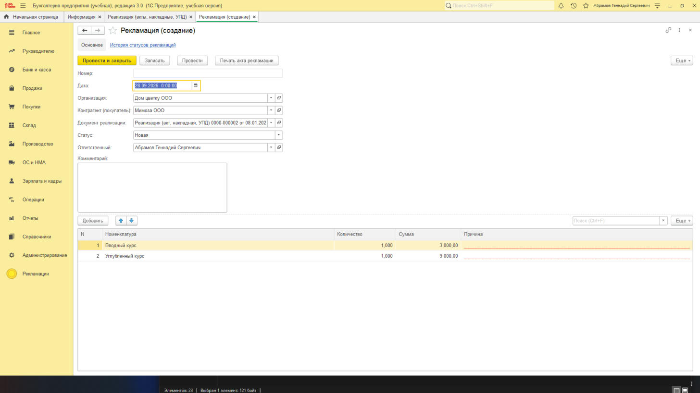
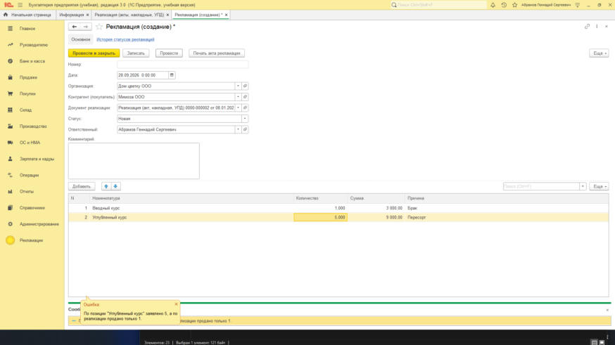
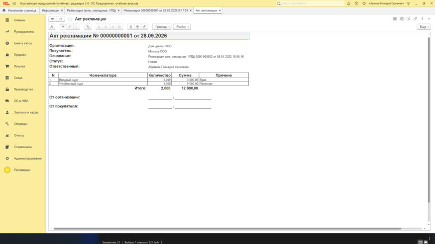
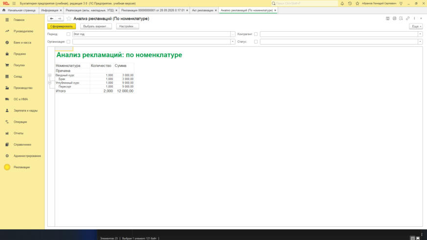

# Рекламации покупателей — расширение для «1С:Бухгалтерия предприятия 3.0»

Учебный проект: доработка типовой конфигурации **без изменения её кода**, только расширением.
Проверено на «1С:Бухгалтерия 8. Учебная версия» (БП 3.0.111, БСП 3.1.5, платформа 8.3.27).

Покупатель сообщает о проблеме с товаром или услугой: брак, недовоз, пересорт. Менеджер создаёт
рекламацию прямо из реализации, рекламация проходит статусы
«Новая → На рассмотрении → Удовлетворена / Отклонена», печатается акт, руководитель видит аналитику.



## Что сделано

| Объект (префикс `рек_`) | Что делает |
|---|---|
| `Документ.рек_Рекламация` | Шапка: организация, покупатель, документ реализации, статус, ответственный, комментарий. ТЧ «Товары»: номенклатура, количество, сумма, причина. |
| Ввод на основании | Штатное свойство «Вводится на основании» = `РеализацияТоваровУслуг`. БСП сама показывает команду в своём подменю «Создать на основании». Заполнение берёт товары **и** услуги реализации, одинаковая номенклатура сворачивается в одну строку. По непроведённой реализации рекламацию не создать. |
| Проверка количества | Нельзя заявить больше, чем продано. Сравнение по сгруппированной номенклатуре (временные таблицы), чтобы одна позиция в нескольких строках не обходила проверку. |
| `РегистрНакопления.рек_Рекламации` (обороты) | Движения при проведении: организация, контрагент, номенклатура, причина, статус → количество, сумма. |
| `РегистрСведений.рек_ИсторияСтатусов` | Независимый, периодический до секунды. Каждая смена статуса пишется кодом при записи документа: кто, когда, на какой статус. |
| `Отчет.рек_АнализРекламаций` | СКД, 4 варианта: по номенклатуре, по контрагентам, по причинам и статусам, по месяцам. Отборы по периоду, организации, контрагенту, статусу. |
| Печатная форма «Акт рекламации» | Кнопка на форме документа. Табличный документ строится кодом в модуле менеджера. |
| Перехват типового кода | `РеализацияТоваровУслуг`: `&Перед("ОбработкаУдаленияПроведения")` — нельзя отменить проведение реализации, по которой есть проведённая рекламация. Типовой модуль не меняется. |
| `Справочник.рек_ПричиныРекламаций`, `Перечисление.рек_СтатусыРекламаций` | Справочные данные. |
| `Роль.рек_ОсновнаяРоль` | Основная роль расширения: платформа выдаёт её всем пользователям, в ней права на объекты расширения. |
| `Подсистема.рек_Рекламации` | Отдельный раздел в интерфейсе. |

Заимствованы только типы, на которые ссылаются реквизиты (`Контрагенты`, `Номенклатура`, `Организации`,
`Пользователи`) и `РеализацияТоваровУслуг` (ввод на основании и перехват).

## Результаты проверки в базе

| Сценарий | Результат |
|---|---|
| Раздел «Рекламации» виден пользователю без ручной выдачи ролей | ✅ |
| «Создать на основании» из реализации → «Рекламация»: шапка и строки заполнены | ✅ (демо-реализации — услуги) |
| Количество больше проданного → проведение отклонено с сообщением | ✅  |
| Проведение, печать «Акта рекламации» | ✅  |
| Отчёт «Анализ рекламаций» | ✅  |
| Загрузка из XML, `/UpdateDBCfg`, синтаксический контроль модулей (`load.bat`) | ✅ |
| Запрет отмены проведения реализации | код загружен, вручную не прогонялся |

## Решения и ограничения

- **Почему не подсистема «Печать» БСП.** В учебной БП БСП не регистрирует идентификаторы объектов расширений,
  из-за этого механизмы БСП, завязанные на них (печать, общая форма отчётов), для объектов расширения работают
  ненадёжно. Поэтому печать — собственной командой формы, а у отчёта своя форма на базе платформенной.
- **Формы** документа и отчёта созданы конструктором Конфигуратора, код модулей написан отдельно.
- **Режим совместимости расширения** 8.3.16 — как у основной конфигурации.
- Печать и сохранение табличных документов в учебной версии отключены: акт показывается на экране.

## Структура и сборка

```
src\            исходники расширения (выгрузка Конфигуратора, формат Hierarchical)
tools\*.ps1     выгрузка/загрузка через пакетный режим Конфигуратора
dump.bat        база -> src
load.bat        src -> база: загрузка расширения, /UpdateDBCfg -Extension, /CheckModules
dump-base.bat   выгрузка основной конфигурации в base-src\ (справочник по типовым объектам, в git не входит)
```

1. Учебная «1С:Бухгалтерия 8» с online.1c.ru, файловая база (демо).
2. `.1c-devbase.ps1.example` → `.1c-devbase.ps1`, указать путь к базе и пользователя.
3. `load.bat` — создаст в базе расширение `Рекламации` из `src`.

## Дальше

- [ ] HTTP-сервис (REST): приём рекламаций с сайта и запрос статуса
- [ ] Уведомления в Telegram при смене статуса, регламентное задание по просроченным рекламациям
- [ ] Обновление БП на новый релиз и проверка расширения
